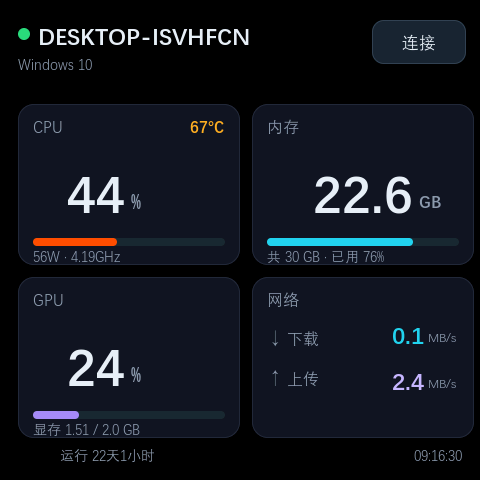
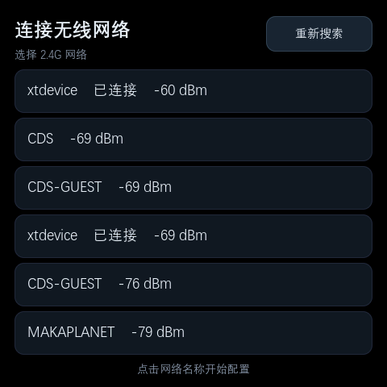
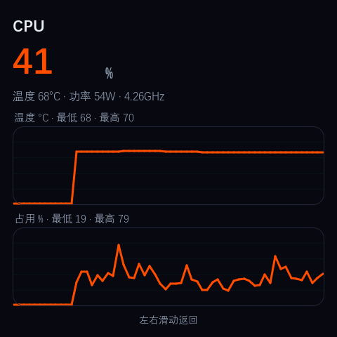
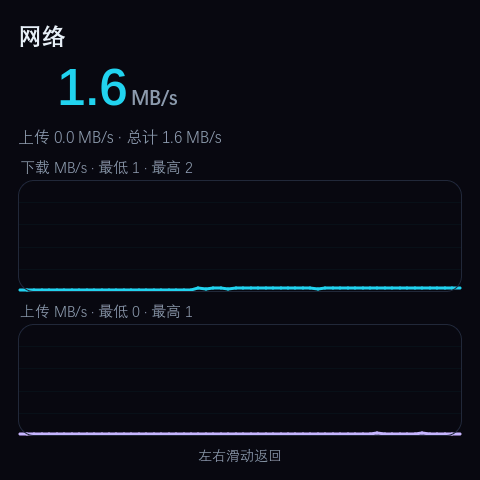
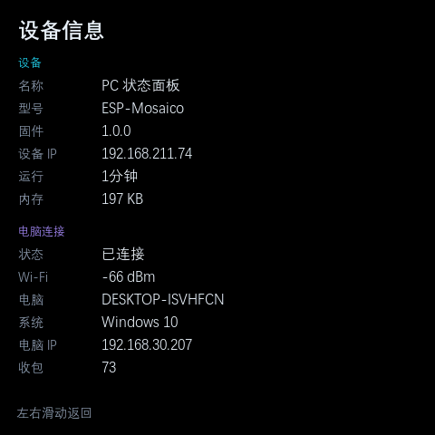
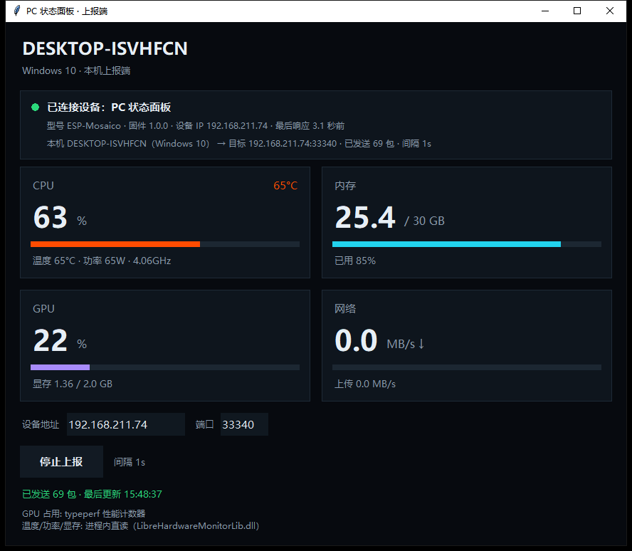

# PC 状态面板

把 Windows 电脑的实时硬件状态显示在 ESP-Mosaico 的 480×480 触摸屏上：**CPU / 内存 / GPU / 网络**
四张卡片，点开还有折线趋势。设备通过 Wi-Fi 直接接收电脑上报的状态数据 —— **不投屏、不传图像**，
每秒一包（约 200 字节），对电脑和网络的负担都很小。

## 面板上有什么

| 卡片 | 显示内容 |
| --- | --- |
| **CPU** | 占用率（大号数字）+ 温度、功率、频率 |
| **内存** | 已用容量 / 总容量、已用百分比 |
| **GPU** | 占用率 + 显存占用 |
| **网络** | 实时下载 / 上传速率（MB/s） |

- **详情页**：点任意卡片进入。顶部是实时读数，下面两张折线图 —— CPU 是「温度 + 占用」、
  内存是「占用 + 已用容量」、显卡是「温度 + 显存」、网络是「下载 + 上传」，每张图都标注本次
  窗口内的最低 / 最高值。
- **设备信息页**：设备名称、型号、固件版本、设备 IP、运行时长、可用内存，以及电脑连接状态
  （Wi-Fi 信号强度、电脑名、系统、电脑 IP、累计收到的包数）。
- **触摸配网**：第一次开机在屏幕上选 2.4G 网络、用软键盘输入密码，凭据保存在设备里，断电不丢。
  Wi-Fi 列表里会标出已连接的网络与信号强度。
- **自动转屏**：按重力方向自动旋转，横放竖放都合适。
- **时钟与运行时长**：顶部显示电脑名与系统，右下角显示时钟（时间由电脑下发校准，不需要板载 RTC）。

## 电脑端（Windows 客户端）

- 一个窗口 + **一个托盘图标**：关掉窗口就缩到托盘继续上报，托盘颜色表示连接状态，右键可
  「显示窗口 / 退出」。
- 传感器**在客户端进程内直读**（`LibreHardwareMonitorLib` + pythonnet），不需要单独安装或常驻
  LibreHardwareMonitor，托盘里不会多出别的图标。
- 采集方式：`psutil`（CPU / 内存 / 网络）+ `typeperf`（GPU 占用）+ LibreHardwareMonitor
  （温度、功率、显存）。
- 可以打包成**单文件 exe**，拷到其他电脑上双击即用，目标电脑不用装 Python。
- **下载**：[`pc_status_panel-1.0.0-win64.zip`](https://github.com/LaiGZ/esp-mosaico-pc-panel/releases/download/v1.0.0/pc_status_panel-1.0.0-win64.zip)
  —— 解压到一个可写目录后双击 `pc_status_panel.exe`；包内含使用说明与第三方组件许可。

## 快速上手

1. **给设备联网**：设备开机若未联网会进入配网页 —— 选择 2.4G Wi-Fi、输入密码。
2. **在电脑上运行客户端**：填入设备屏幕上显示的 IP（端口默认 `33340`），点「开始上报」。
3. **配对**：客户端窗口里有一个 4 位配对码；设备屏幕上点「匹配」，用数字键盘输入这 4 位码。
   配对成功后设备只显示这台电脑的数据，同一网段有多台电脑也不会串台。想换电脑时，在设备信息页
   点「重新配对」再输入新电脑的码即可。
4. 完成后设备每秒刷新一次；如果电脑侧 5 秒没有数据，设备会显示「等待连接」。

## 硬件与运行条件

| 项目 | 要求 |
| --- | --- |
| 开发板 | ESP-Mosaico（ESP32-S31，480×480 触摸屏） |
| 网络 | 设备使用 2.4G Wi-Fi；设备与电脑需能互通（默认 UDP 端口 `33340`），跨网段时在客户端里填设备 IP |
| 电脑 | Windows 10 / 11（x64） |
| 设备端依赖 | `espressif/esp-gsp 1.5.1`、`lvgl 9.5.0`、ESP-Mosaico BSP、ESP-Iris |

## 已知限制

- 电脑端目前只有 **Windows** 版本。温度 / 功率 / 显存等需要 LibreHardwareMonitor 的内核驱动，
  **第一次读取会弹一次 UAC 授权**；不授权也能用，只是这几项显示为 `--`。
- GPU 占用率走 Windows 性能计数器（`typeperf`），个别显卡 / 驱动不提供该计数器时显示 0。
- 网络速率只统计物理网卡，已排除回环与虚拟网卡。
- 一次只绑定一台电脑；多台电脑之间目前需要手动「重新配对」切换。
- 目前只在一台 Windows 10 电脑 + 一块 ESP-Mosaico 上实测通过（面板、详情页、配对、托盘客户端
  均已跑通）；其他 Windows 版本、显卡品牌与路由器环境尚未逐一验证。

## 许可与致谢

- 应用代码：Apache-2.0（见仓库 `LICENSE`）。界面字体是从系统字体切出的子集，再分发前请替换，
  说明见 `ui/fonts/NOTICE.md`。
- 移植自开源项目 [ESP32C3-PC-Wireless-Display](https://github.com/WuyongLab/ESP32C3-PC-Wireless-Display)
  的「电脑硬件状态显示」能力，按 480×480 触摸屏重新设计了界面，并去掉了桌面投屏部分。
- 传感器读取使用 [LibreHardwareMonitor](https://github.com/LibreHardwareMonitor/LibreHardwareMonitor)
  的库（MPL-2.0）。
- 源码、版本记录与 Windows 客户端下载：
  [github.com/LaiGZ/esp-mosaico-pc-panel](https://github.com/LaiGZ/esp-mosaico-pc-panel)
